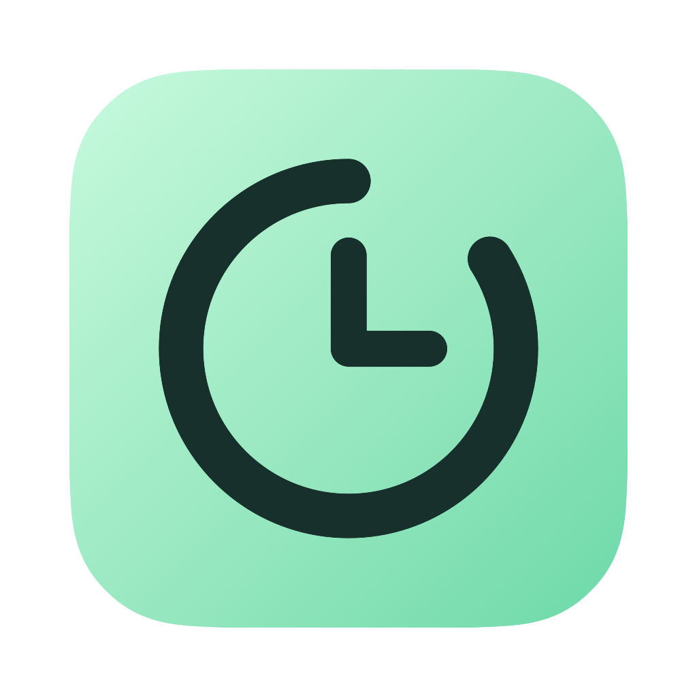

<p align="center"></p>

# Codex Usage & Tibo Reset Monitor for macOS — Codex Jet

**Track Codex usage, see your quota burn rate, and follow Tibo reset announcements from the macOS menu bar.** Codex Jet combines account quota monitoring, usage history, hourly token usage by model, and reset reminders in one native app.

Check how much Codex quota remains, whether your current pace can last until the nearest deadline, and how much is projected to remain. Weekly subscription resets, temporary reset signals from [codex-reset.com](https://codex-reset.com/), and banked-card expiry are shown with their own sources and limits.

**English · [简体中文](README.zh-CN.md)** · [Download for macOS](https://github.com/StarrHuang/codex-jet/releases/latest) · [Install and update](docs/deployment.md) · [Verification](docs/verification.md)

Requires macOS 14 or later and an installed, signed-in Codex CLI. Universal builds support Apple Silicon and Intel Macs. The interface supports Simplified Chinese, English, and following the macOS system language.

## Codex usage tracking: quota, history, and token consumption

- **Current Codex quota:** show the account's returned usage windows and remaining percentage; distinguish fresh, stale, and missing readings.
- **Menu bar usage monitor:** a compact clock logo, remaining quota, and nearest eligible countdown. More than 48 hours displays in days.
- **Quota consumption curve:** keep the full curve visible by default in the menu bar popover, with time ranges, observed changes, and sampling gaps.
- **Hourly token usage by model:** inspect local Codex session usage records by hour and model, including input, cached input, output, and reasoning subtotals.
- **Usage history on this Mac:** keep account-separated quota observations locally. History begins when the app records it; missing hours are not invented.

## Codex burn rate: will your quota last until reset?

The dashboard and menu bar popover share the same current balance, nearest eligible deadline, and measured pace. They show projected remaining quota, an estimated exhaustion time when available, and a conditional pace adjustment.

The nearest target can be the normal weekly reset, a fresh timed official reset announcement/window, or an unexpired banked card for the same account. Card expiry means **redeem manually**, not an automatic refill. A site-only observation does not create a personal reset countdown.

The status logo is green when measured pace leaves a buffer, yellow within 10% of the rate needed to reach the target, red when pace is more than 10% faster than required or quota is exhausted, and gray when a valid assessment is unavailable. Measured recent pace and window-average estimates remain separate; projections assume future work resembles recent use.

The quota clock's colored arc represents the latest observed balance. Its hand speed represents recent measured consumption, not actual time. An announcement rim is a reminder; only a new account reading changes the displayed balance.

## Tibo reset alerts and the codex-reset.com radar

Looking for **Codex Tibo reset** updates? Codex Jet brings the third-party global reset radar into the app alongside your own Codex usage. Here, “Tibo reset” refers to extra-reset announcements and signals tracked through codex-reset.com; it is a community search term, not a separate account entitlement.

- Follow temporary reset announcements, available timing, source links, confidence, and update time.
- See reset countdowns when the source provides an eligible future target, with source and time-conversion details.
- Receive reset reminders and review the pace needed if you choose to use the current balance before a target.
- View banked-reset card expiry and manual-redemption scenarios separately from weekly and temporary resets.

**A global reset signal does not prove that your account has received more quota.** Untimed, stale, historical, or unverified signals retain those labels. Personal quota always comes from your authenticated account reading.

## Install or update Codex Jet

Download the universal release from [GitHub Releases](https://github.com/StarrHuang/codex-jet/releases/latest), or install from a clone:

```sh
git clone https://github.com/StarrHuang/codex-jet.git
cd codex-jet
./scripts/install.sh
```

The installer checks the release checksum and app signature before installing to `~/Applications/Codex Jet.app`. For updates, quit Codex Jet and rerun the installer. Each Mac uses its own Codex sign-in and local history. The release is ad-hoc signed and has not been notarized with an Apple Developer ID.

To build from source:

```sh
./scripts/build-app.sh
open 'dist/Codex Jet.app'
```

See [macOS installation and deployment](docs/deployment.md) for archive installation, update options, and release packaging, and [behavior and motion verification](docs/verification.md) for the test entrypoints.

## Frequently asked questions

### Is Codex token usage the same as subscription quota?

No. Token summaries describe local recorded activity, while quota percentages come from the account. Codex Jet does not convert tokens into subscription percentages or infer model-level quota shares from token totals. Token activity may include multiple accounts or providers and is not bound to the current subscription quota.

### Can it predict exactly when Codex will reset or run out?

It shows the returned weekly reset time and eligible announcement targets, then estimates usage from measured pace. Future workload and service rules can change. A forecast or Tibo reset signal is not a guarantee; stale or insufficient data stays unknown.

### Does it redeem reset cards or consume quota automatically?

No. Banked cards require manual redemption. Codex Jet monitors usage and helps plan real work; it does not start model-generation requests or spend quota automatically.

## Local data, privacy, and account boundaries

Quota and banked-card readings use the current Mac's existing Codex sign-in. Codex Jet does not bundle credentials or upload quota history. Account-separated history is stored in `~/Library/Application Support/CodexReset/history.json`, using a one-way account key without storing the account email. The key is not an anonymity guarantee.

Token summaries use local session usage metadata, not conversation content for the summary. Empty hours mean no usage record was found, not verified zero usage. The global radar is fetched separately from codex-reset.com; those requests do not include personal quota or account data.

## Credits and independence

Codex Jet is an independent community project, not affiliated with or endorsed by OpenAI, Tibo, or codex-reset.com.

- [codex-reset.com](https://codex-reset.com/) supplies the independent public global reset radar. Thank you for making the reset signals and timeline available.
- The compact weekly quota-card presentation was inspired by the Tokei app. No Tokei source code or artwork is included.
- [CodexBar](https://github.com/steipete/CodexBar) informed the window-pace comparison and provided product and implementation ideas. Codex Jet's implementation is independent.
